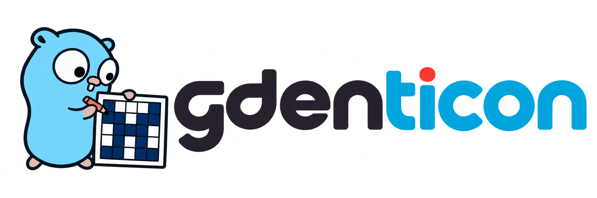
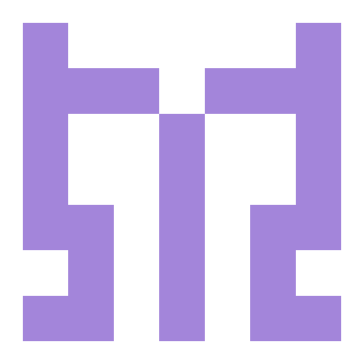
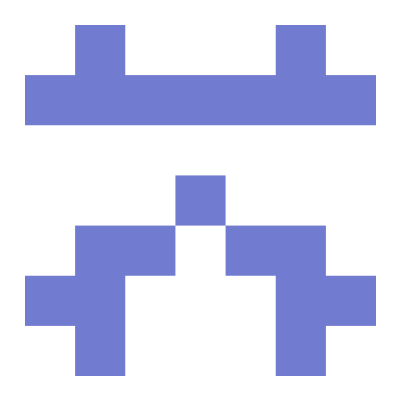
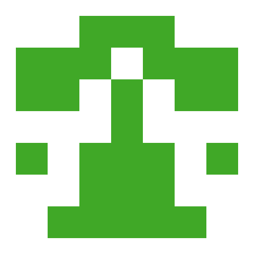

<div align="center">
  <p><strong>English</strong> · <a href="README.zh-CN.md">简体中文</a></p>

  

  <h3>Generate mirrored pixel avatars from any string.</h3>
  <p>Available as a Go library and a fast, cross-platform CLI.</p>

  <p>
    <a href="https://github.com/hourinX/gdenticon/actions/workflows/test.yml"></a>
    <a href="https://codecov.io/gh/hourinX/gdenticon"></a>
    <a href="https://pkg.go.dev/github.com/hourinX/gdenticon/v2/pkg/gdenticon"></a>
    <a href="https://github.com/hourinX/gdenticon/releases"></a>
    <a href="LICENSE"></a>
  </p>

  <p>
    
    
    
    
    
  </p>

  <sub>Different inputs produce distinct, deterministic avatars. The same input and options always reproduce the same result.</sub>
</div>

## Why gdenticon?

- Generate stable avatars from usernames, emails, account IDs, or any string.
- Create balanced mirrored patterns with automatic, contrast-aware colours.
- Export as **PNG, SVG, JPEG, GIF, BMP, or TIFF**.
- Use the same engine from Go code, scripts, or the interactive CLI.
- Write to files, HTTP responses, memory, object storage, or any `io.Writer`.

## Installation

### Download a prebuilt binary

No Go installation is required. Download a ready-to-run package for Windows,
macOS, or Linux from the
[latest GitHub Release](https://github.com/hourinX/gdenticon/releases/latest).
AMD64 and ARM64 builds are available.

### Install with Go

gdenticon requires Go 1.24 or later.

```sh
go install github.com/hourinX/gdenticon/v2/cmd/gdenticon@latest
```

Add the library to an existing Go module:

```sh
go get github.com/hourinX/gdenticon/v2@latest
```

## Quick start

The identifier is the only required argument:

```sh
gdenticon alice@example.com
```

Every flag is optional:

| Value | Required | Default | Description |
| --- | --- | --- | --- |
| `<id>` | Yes | — | Username, email, account ID, or any string |
| `--grid` | No | `5` | Logical grid side length |
| `--size` | No | `256` | Output width and height in pixels |
| `--mirror` | No | `true` | Mirror the left half onto the right |
| `--style` | No | `balanced` | `balanced` or `classic` pattern |
| `--hash` | No | `md5` | Digest algorithm, such as `sha256` |
| `--format` | No | `png` | `png`, `svg`, `jpeg`, `gif`, `bmp`, or `tiff` |
| `--fg` | No | Hash-derived | Foreground colour as `#rrggbb` or `#rrggbbaa` |
| `--bg` | No | `#ffffff` | Background colour as `#rrggbb` or `#rrggbbaa` |
| `--output` | No | System temp directory | Base output directory |

A fully specified command:

```sh
gdenticon first@example.com --grid 7 --size 512 --mirror=true --style balanced --hash sha256 --format png --fg "#2563eb" --bg "#f5f8ff" --output "avatars"
```

The command above applies when the directory containing the gdenticon
executable has been added to the `PATH` environment variable. Without that
configuration, replace `gdenticon` with `.\gdenticon.exe` in Windows PowerShell
or `./gdenticon` on Linux and macOS.

`--output` accepts either an absolute or relative base directory. A relative
path is resolved from the directory in which the command is executed, so
`--output "avatars"` writes files below `<current-directory>/avatars/gdenticon`.
When `--output` is omitted, gdenticon uses the operating system's temporary
directory. The command always prints the final generated file path.

### Interactive mode

Run `gdenticon` without arguments, or use `gdenticon shell`. Inside interactive
mode, `generate` is required before the identifier; all flags remain optional:

```text
gdenticon interactive mode
Type "help" for commands and "exit" to quit.

gdenticon> generate alice@example.com --format png --size 512

Created:
  C:\Users\...\Temp\gdenticon\e804324253b682bf.png
```

Interactive sessions also track their outputs:

- `outputs` lists files generated or resolved during the current session.
- `remove <number|filename|last>` removes one recorded output.
- `clean` confirms, then removes files newly created in the current session
  across every output directory. Historical and unrelated files are preserved.

## Go library

Generation and encoding are separate, so one logical icon can be delivered
through any `io.Writer`.

```go
package main

import (
    "bytes"

    "github.com/hourinX/gdenticon/v2/pkg/gdenticon"
)

func main() {
    icon, err := gdenticon.Generate("alice@example.com", gdenticon.GenerateOptions{
        GridSize: 5,
        Mirror:   true,
        Format:   gdenticon.FormatPNG,
    })
    if err != nil {
        panic(err)
    }

    var output bytes.Buffer
    if err := gdenticon.Write(&output, icon, gdenticon.WriteOptions{Size: 256}); err != nil {
        panic(err)
    }
}
```

See the complete API on
[pkg.go.dev](https://pkg.go.dev/github.com/hourinX/gdenticon/v2/pkg/gdenticon)
and run `gdenticon --help` for all command-line options.

## License

Source code is available under the [MIT License](LICENSE). Brand artwork
attribution is documented in [NOTICE](NOTICE).
