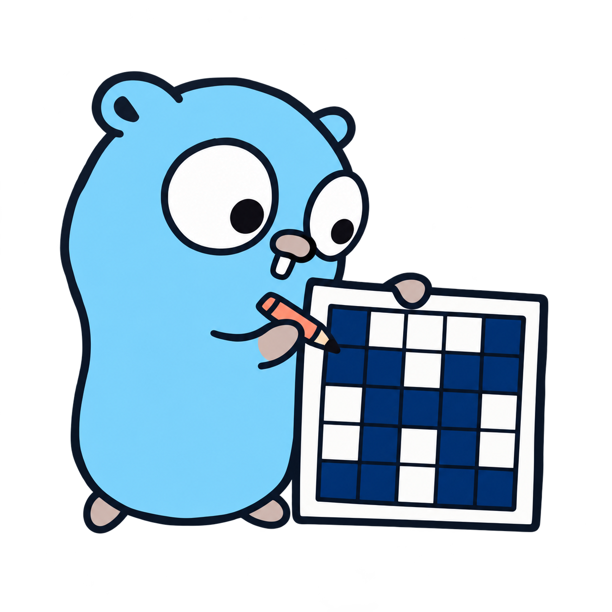

<div align="center">
  

  <p><strong>Deterministic, configurable identicon generation for Go.</strong></p>

  <p>
    <a href="https://github.com/hourinX/gdenticon/actions/workflows/test.yml"></a>
    <a href="https://codecov.io/gh/hourinX/gdenticon"></a>
    <a href="https://pkg.go.dev/github.com/hourinX/gdenticon/v2/pkg/gdenticon"></a>
    <a href="https://github.com/hourinX/gdenticon/releases"></a>
    <a href="LICENSE"></a>
  </p>
</div>

`gdenticon` turns a username, email address, account ID, or any other string
into a stable grid avatar. The same identifier and configuration always produce
the same icon, making it suitable for profile placeholders, developer tools,
dashboards, and generated data.

The project provides both a Go package and a command-line program. It supports
mirrored and balanced patterns, hash-derived or fixed colours, configurable
sizes, and PNG, SVG, JPEG, GIF, BMP, and TIFF output.

## Installation

Install the command-line program:

```sh
go install github.com/hourinX/gdenticon/v2/cmd/gdenticon@latest
```

Add the library to a Go module:

```sh
go get github.com/hourinX/gdenticon/v2@latest
```

Prebuilt executables are available from
[GitHub Releases](https://github.com/hourinX/gdenticon/releases).

gdenticon requires Go 1.26 or later. Command-line options are documented by
`gdenticon --help`; the public Go API is available on
[pkg.go.dev](https://pkg.go.dev/github.com/hourinX/gdenticon/v2/pkg/gdenticon).

## Command line

Pass an identifier directly for regular command-line use:

```sh
gdenticon alice@example.com --format png --size 512
```

Run `gdenticon` without arguments, or use `gdenticon shell`, to enter the
interactive command mode. Inside it, use `generate <id> [flags]`; enter `help`
to list commands and `exit` to leave.

When no output directory is specified, the command stores generated files in
the `gdenticon` directory below Go's operating-system temporary directory. This
is normally `/tmp/gdenticon` on Linux and
`%LOCALAPPDATA%\Temp\gdenticon` on Windows.

## Mascot and artwork

<p align="center">
  
</p>

The gdenticon mascot is an adaptation inspired by the Go Gopher. The original
Go Gopher was designed by [Renee French](https://reneefrench.blogspot.com/) and
is licensed under the
[Creative Commons Attribution 4.0 License](https://creativecommons.org/licenses/by/4.0/).
The character has been adapted to depict a designer drawing a mirrored
identicon grid.

## License

The source code is available under the [MIT License](LICENSE).
