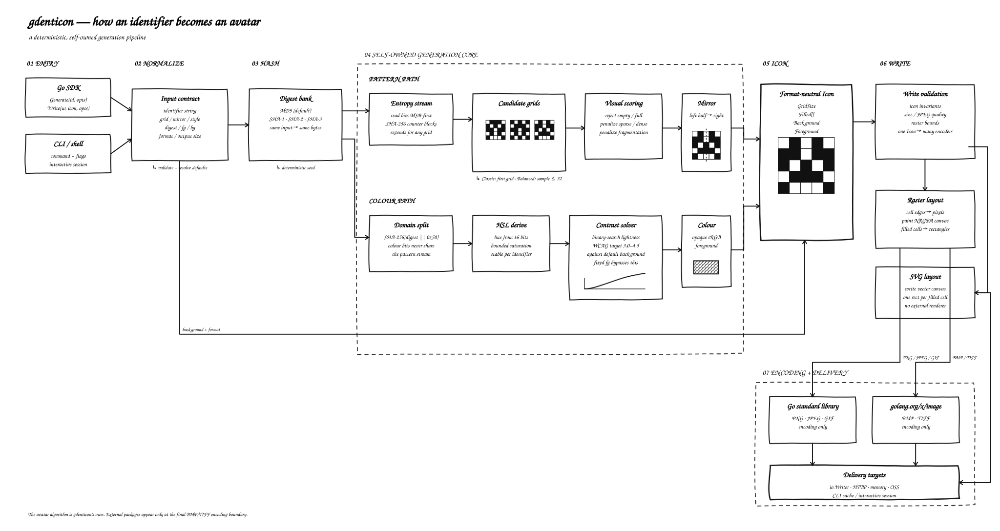

<div align="center">
  <p><a href="README.md">English</a> · <strong>简体中文</strong></p>

  

  <h3>从任意字符串生成镜像像素头像。</h3>
  <p>既是 Go 软件包，也是快速、跨平台的命令行工具。</p>

  <p>
    <a href="https://github.com/hourinX/gdenticon/actions/workflows/test.yml"></a>
    <a href="https://codecov.io/gh/hourinX/gdenticon"></a>
    <a href="https://pkg.go.dev/github.com/hourinX/gdenticon/v2/pkg/gdenticon"></a>
    <a href="https://github.com/hourinX/gdenticon/releases"></a>
    <a href="LICENSE"></a>
  </p>

  <p>
    
    
    
    
    
  </p>

  <sub>不同输入会产生不同的确定性头像；相同输入与配置始终得到相同结果。</sub>
</div>

## 为什么选择 gdenticon？

- 从用户名、邮箱、账户 ID 或任意字符串生成稳定头像。
- 生成平衡的镜像图案，并自动选择具有可读对比度的颜色。
- 支持 **PNG、SVG、JPEG、GIF、BMP 和 TIFF**。
- 在 Go 代码、自动化脚本或交互式 CLI 中复用同一套生成引擎。
- 可写入文件、HTTP 响应、内存、对象存储或任意 `io.Writer`。

## 架构



## 安装

### 下载预编译程序

无需安装 Go。前往
[最新 GitHub Release](https://github.com/hourinX/gdenticon/releases/latest)
下载适用于 Windows、macOS 或 Linux 的可执行程序，同时提供 AMD64 和 ARM64 版本。

### 使用 Go 安装

gdenticon 需要 Go 1.24 或更高版本。

```sh
go install github.com/hourinX/gdenticon/v2/cmd/gdenticon@latest
```

添加到现有 Go 模块：

```sh
go get github.com/hourinX/gdenticon/v2@latest
```

## 快速开始

只有标识符是必填参数：

```sh
gdenticon alice@example.com
```

如需更丰富的图案细节，推荐从 `--grid 7` 开始；默认值 `5` 会生成单元格更大、
视觉更简洁的头像。

其余参数全部选填：

| 参数 | 必填 | 默认值 | 说明 |
| --- | --- | --- | --- |
| `<id>` | 是 | — | 用户名、邮箱、账户 ID 或任意字符串 |
| `--grid` | 否 | `5` | 逻辑网格边长 |
| `--size` | 否 | `256` | 输出图片的宽度和高度，单位为像素 |
| `--mirror` | 否 | `true` | 将左半部分镜像到右侧 |
| `--style` | 否 | `balanced` | `balanced` 或 `classic` 图案模式 |
| `--hash` | 否 | `md5` | 摘要算法，例如 `sha256` |
| `--format` | 否 | `png` | `png`、`svg`、`jpeg`、`gif`、`bmp` 或 `tiff` |
| `--fg` | 否 | 根据哈希生成 | 前景色，格式为 `#rrggbb` 或 `#rrggbbaa` |
| `--bg` | 否 | `#ffffff` | 背景色，格式为 `#rrggbb` 或 `#rrggbbaa` |
| `--output` | 否 | 系统临时目录 | 输出基础目录 |

完整指定所有参数的命令：

```sh
gdenticon first@example.com --grid 7 --size 512 --mirror=true --style balanced --hash sha256 --format png --fg "#2563eb" --bg "#f5f8ff" --output "avatars"
```

上述命令适用于已将 gdenticon 可执行文件所在目录加入 `PATH` 环境变量的情况。
如果尚未配置 `PATH`，请在 Windows PowerShell 中将命令开头的 `gdenticon`
替换为 `.\gdenticon.exe`，在 Linux 和 macOS 中替换为 `./gdenticon`。

`--output` 支持绝对路径和相对路径。相对路径以执行命令时所在的当前目录为
基准，因此 `--output "avatars"` 会将文件写入
`<当前目录>/avatars/gdenticon`。省略 `--output` 时，gdenticon 使用操作系统
临时目录。命令始终会输出最终生成文件的完整路径。

### 交互模式

不带参数运行 `gdenticon`，或者执行 `gdenticon shell`。交互模式中必须先输入
`generate` 再输入标识符，其余参数仍然全部选填：

```text
gdenticon interactive mode
Type "help" for commands and "exit" to quit.

gdenticon> generate alice@example.com --format png --size 512

Created:
  C:\Users\...\Temp\gdenticon\e804324253b682bf.png
```

交互会话还会记录本次输出：

- `outputs`：列出当前会话生成或命中的文件。
- `remove <编号|文件名|last>`：删除一条已记录的输出。
- `clean`：确认后，跨所有输出目录删除当前会话中新建的文件；历史文件和无关
  文件不会被删除。

## Go 软件包

生成与编码彼此分离，因此同一个逻辑头像可以通过任意 `io.Writer` 输出。

```go
package main

import (
    "bytes"

    "github.com/hourinX/gdenticon/v2/pkg/gdenticon"
)

func main() {
    icon, err := gdenticon.Generate("alice@example.com", gdenticon.GenerateOptions{
        GridSize: 5,
        Mirror:   true,
        Format:   gdenticon.FormatPNG,
    })
    if err != nil {
        panic(err)
    }

    var output bytes.Buffer
    if err := gdenticon.Write(&output, icon, gdenticon.WriteOptions{Size: 256}); err != nil {
        panic(err)
    }
}
```

完整 API 请参阅
[pkg.go.dev](https://pkg.go.dev/github.com/hourinX/gdenticon/v2/pkg/gdenticon)；
使用 `gdenticon --help` 查看所有命令行选项。

## 许可证

源代码采用 [MIT License](LICENSE) 发布。品牌图素材的署名信息记录在
[NOTICE](NOTICE) 中。
